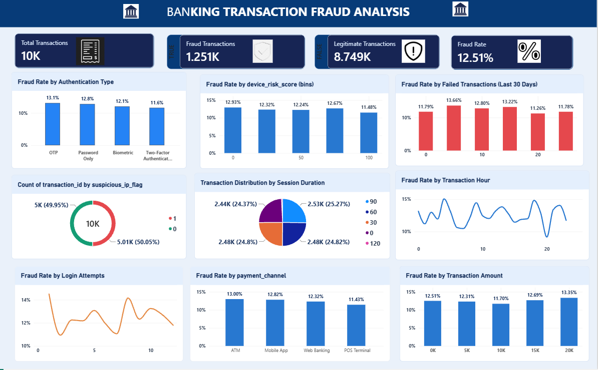

# Banking Transaction Fraud Analysis

## Project Overview
This project focuses on analyzing banking transactions to identify fraudulent activities and understand transaction risk patterns using MySQL and Power BI.

## Tools & Technologies
- MySQL
- Power BI
- SQL
- Data Visualization

## Dataset
- Total Transactions: 10,000
- Fraud Transactions: 1,251
- Legitimate Transactions: 8,749
- Fraud Rate: 12.51%

## Dashboard Preview

## Key Analysis
- Fraud rate by authentication type
- Fraud rate by device risk score
- Failed transaction analysis
- Suspicious IP analysis
- Session duration analysis
- Transaction hour analysis
- Login attempts analysis
- Payment channel analysis
- Transaction amount analysis

## Project Files
- `SQL File` – SQL queries used for analysis.
- `fraud_dashboard.png` – Power BI dashboard screenshot.

## Conclusion
This project helps understand transaction fraud patterns and provides insights through interactive Power BI visualizations.

